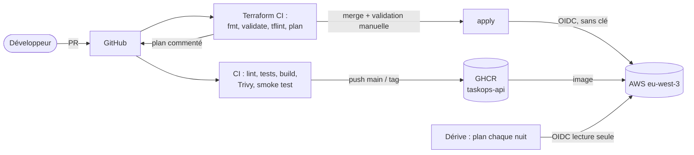
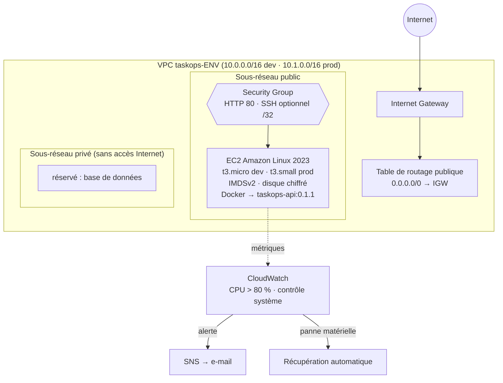
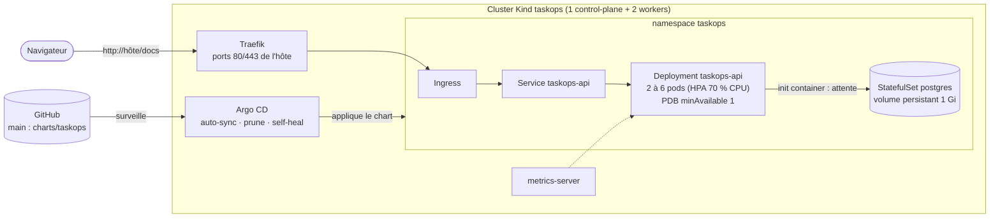

# TaskOps — taskops-platform

[](https://github.com/franckfourrier/taskops-platform/actions/workflows/ci.yml)
[](https://github.com/franckfourrier/taskops-platform/actions/workflows/terraform.yml)
[](https://github.com/franckfourrier/taskops-platform/actions/workflows/drift.yml)
[](https://github.com/franckfourrier/taskops-platform/actions/workflows/k8s.yml)

Plateforme DevOps de bout en bout autour d'une API de gestion de tâches (FastAPI + PostgreSQL) :
CI/CD sécurisée, infrastructure AWS en Terraform pilotée par GitHub Actions (OIDC), Kubernetes
en GitOps (Helm + Argo CD), monitoring Prometheus/Grafana et architecture haute disponibilité.

## Avancement

| # | Projet | Statut |
|---|--------|--------|
| 1 | Pipeline CI/CD (GitHub Actions, Docker, Trivy, GHCR) | ✅ terminé — [v0.1.1](https://github.com/franckfourrier/taskops-platform/releases) |
| 2 | Infrastructure AWS avec Terraform (OIDC, dev/prod, surveillance, dérive) | ✅ terminé |
| 3 | Déploiement Kubernetes (Kind, Helm, HPA, Argo CD / GitOps) | ✅ terminé |
| 4 | Monitoring Prometheus / Grafana / Alertmanager | ⏳ |
| 5 | Architecture haute disponibilité (CloudNativePG, Argo Rollouts, NetworkPolicies) | ⏳ |

## Vue d'ensemble



## L'application

| Route | Rôle |
|-------|------|
| `GET /health` | Health check (`{"status": "ok"}`) utilisé par Docker, la CI, le smoke test et le monitoring |
| `GET /tasks` | Liste les tâches |
| `POST /tasks` | Crée une tâche (`{"title": "...", "done": false}`) |
| `GET /docs` | Documentation interactive (Swagger UI générée par FastAPI) |

Configuration : variable `DATABASE_URL` (PostgreSQL en compose/CI/K8s, SQLite dans `/srv/data` par défaut).

---

## Projet 1 — Pipeline CI/CD

### Stack et choix

| Outil | Rôle | Pourquoi |
|-------|------|----------|
| GitHub Actions | CI/CD | Intégré au dépôt, gratuit pour un dépôt public |
| pytest + PostgreSQL (service CI) | Tests | Tests contre une vraie base, comme en prod |
| Ruff | Lint + format (+ règles de sécurité `S`) | Très rapide, remplace flake8/isort/black |
| Docker multi-étapes, `python:3.12-slim` | Image | Légère (≈ 177 Mo, 55,7 Mo compressée), non-root, avec HEALTHCHECK |
| Smoke test | Démarrage réel | L'image doit répondre sur `/health` en moins de 30 s |
| Trivy | Scan de vulnérabilités | Bloque le pipeline sur une faille CRITICAL corrigeable |
| GHCR | Registre | Authentification par `GITHUB_TOKEN`, aucun secret à gérer |

### Pipeline

```
push / PR ─► lint (ruff) ─► tests (pytest + Postgres) ─► build ─► smoke test ─► scan Trivy ─► push GHCR
                                                                                    (main et tags v* uniquement)
```

Tags produits : SHA complet du commit, `latest` sur `main`, et `1.2.3` / `1.2` sur une release `v1.2.3`.

### Gouvernance et sécurité

- Branche `main` **protégée** (ruleset) : PR obligatoire, checks requis, force-push et suppression interdits.
- Image exécutée en **non-root** (UID 10001), mises à jour OS appliquées au build.
- Aucun secret dans le code : `GITHUB_TOKEN` éphémère pour GHCR.
- Permissions des workflows au **moindre privilège**, actions GitHub **épinglées par SHA** de commit.

### Lancer en local

```bash
make install && make lint && make test   # venv + lint + tests
make up                                  # API + PostgreSQL via docker compose
until curl -sf localhost:8000/health; do sleep 1; done
curl -X POST localhost:8000/tasks -H 'Content-Type: application/json' -d '{"title":"test"}'
make down
```

---

## Projet 2 — Infrastructure AWS avec Terraform

### Architecture (par environnement)



### Organisation du code

```
terraform/
├── bootstrap/        # bucket S3 du state (chiffré, versionné, privé) — appliqué une seule fois
├── github-oidc/      # fédération GitHub → AWS : rôles taskops-gha-plan / taskops-gha-apply
├── modules/
│   ├── network/      # VPC, sous-réseaux public/privé, IGW, routage
│   ├── compute/      # EC2, Security Group, user_data qui lance l'API
│   └── monitoring/   # SNS + alarmes CloudWatch
├── envs/             # dev.tfvars, prod.tfvars, *.s3.tfbackend (un state par environnement)
└── main.tf, variables.tf, outputs.tf, providers.tf
```

### Workflow Terraform

| Événement | Ce qui se passe |
|-----------|-----------------|
| Pull request | `fmt`, `validate`, `tflint`, puis **plan `dev` et `prod` en parallèle**, publiés en commentaire de la PR |
| Merge sur `main` | `apply` sur **dev**, après **validation manuelle** (environnement GitHub protégé), puis smoke test de l'API |
| Lancement manuel | `plan`, `apply` ou `destroy` sur `dev` ou `prod` — **prod uniquement depuis `main`** |
| Chaque nuit (04:17, Douala) | **Détection de dérive** : `plan -detailed-exitcode` sur dev et prod ; échec si l'infra a été modifiée hors de Terraform |

### Sécurité

- **Aucune clé AWS** dans le dépôt ni dans GitHub : authentification **OIDC** avec des droits temporaires.
  - `taskops-gha-plan` : lecture seule, utilisable uniquement depuis une PR ou `main` de ce dépôt.
  - `taskops-gha-apply` : utilisable uniquement depuis les environnements GitHub protégés `dev` et `prod`.
  - Règles de confiance basées sur les **identifiants immuables** du compte et du dépôt (protection contre la recréation d'un dépôt homonyme).
- State Terraform dans S3 : chiffré, versionné, accès public bloqué, **verrouillage natif** (`use_lockfile`).
- IAM au **moindre privilège** (pas d'`AdministratorAccess`), MFA sur les comptes humains.
- Instance : **IMDSv2 obligatoire**, disque chiffré, SSH **désactivé par défaut**.

### Lancer en local

```bash
cd terraform
terraform init -backend-config=envs/dev.s3.tfbackend
terraform plan -var-file=envs/dev.tfvars -out=tfplan && terraform apply tfplan
terraform plan -destroy -var-file=envs/dev.tfvars -out=destroy.tfplan && terraform apply destroy.tfplan
```

Coût : quelques centimes par heure d'utilisation ; l'infrastructure est détruite après chaque test.

---

## Projet 3 — Kubernetes en GitOps

### Architecture



### Organisation

```
charts/taskops/            # chart Helm de l'application (source de vérité pour Argo CD)
├── values.yaml            # image, réplicas, ressources, PostgreSQL, Ingress, HPA, PDB
└── templates/             # deployment (init container), postgres, service, ingress, hpa, pdb
kubernetes/
├── kind-config.yaml       # cluster local + réglages etcd/leader-election pour VM lente
├── platform/              # valeurs Helm : Traefik, metrics-server, Argo CD
└── argocd/taskops-app.yaml  # Application Argo CD (auto-sync, prune, self-heal)
```

### Points clés

| Sujet | Mise en œuvre |
|-------|---------------|
| Sécurité des pods | non-root (UID 10001), système de fichiers en lecture seule, aucune capability, seccomp `RuntimeDefault` |
| Santé | readiness et liveness probes sur `/health`, `pg_isready` pour PostgreSQL |
| Démarrage ordonné | init container qui attend PostgreSQL avant de lancer l'API |
| Persistance | StatefulSet + volume : données conservées à travers 3 migrations (manifestes → Helm → Argo CD) |
| Autoscaling | HPA 2 à 6 réplicas, validé sous charge (2 → 6 → 2) |
| Disponibilité | PodDisruptionBudget : au moins 1 pod pendant une maintenance |
| GitOps | Argo CD synchronise `main` ; une suppression manuelle est réparée automatiquement (self-heal) |
| Secrets | mot de passe PostgreSQL créé dans le cluster, jamais dans Git (Sealed Secrets prévu au projet 5) |
| CI | `helm lint --strict` + rendu validé par kubeconform à chaque PR |

### Lancer en local

```bash
kind create cluster --config kubernetes/kind-config.yaml
helm upgrade --install traefik traefik/traefik --version 42.4.1 -n traefik --create-namespace -f kubernetes/platform/traefik-values.yaml
helm upgrade --install metrics-server metrics-server/metrics-server -n kube-system -f kubernetes/platform/metrics-server-values.yaml
helm upgrade --install argocd argo/argo-cd --version 10.18.2 -n argocd --create-namespace -f kubernetes/platform/argocd-values.yaml
kubectl create namespace taskops
kubectl -n taskops create secret generic taskops-db --from-literal=POSTGRES_PASSWORD=... --from-literal=DATABASE_URL=...
kubectl apply -f kubernetes/argocd/taskops-app.yaml   # Argo CD déploie le chart depuis GitHub
```

---

## Ce qui a cassé et comment je l'ai réparé

Huit pannes réelles, documentées dans [docs/troubleshooting.md](docs/troubleshooting.md) :

1. `Connection reset` juste après `make up` — « démarré » n'est pas « prêt ».
2. Image au-dessus de 200 Mo — `pip` et `.pyc` embarqués dans le venv.
3. Conteneur seul en échec — SQLite non inscriptible par l'utilisateur non-root.
4. Clé d'accès AWS exposée — rotation immédiate sans afficher le nouveau secret.
5. GitHub Actions refusé par AWS — nouveau format du sujet OIDC (identifiants immuables).
6. Scheduler et controller-manager en boucle — etcd lent sur VM, baux de leader perdus.
7. Init container bloqué — `pg_isready` sans utilisateur explicite en non-root (« no attempt »).
8. Argo CD bloqué en « Progressing » — Ingress sans adresse ; rolling update impossible avec `hostPort`.

## Améliorations prévues

- Migrations de schéma avec Alembic (au lieu de `create_all`).
- Signature des images (cosign) et SBOM.
- Route `/` redirigeant vers `/docs`.
